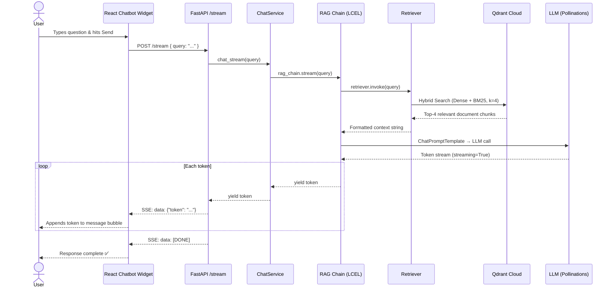
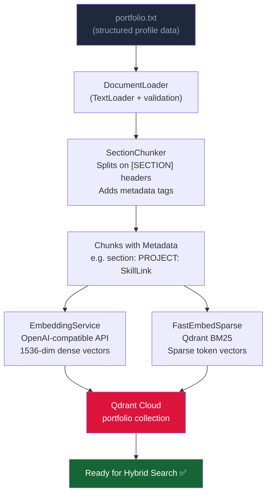

# 🤖 Portfolio Chatbot — AI-Powered RAG Personal Assistant

> An intelligent chatbot embedded in a personal portfolio website that answers questions about Pravesh Verma's experience, skills, and projects using a **Retrieval-Augmented Generation (RAG)** pipeline with **Hybrid Search**.

[](https://fastapi.tiangolo.com)
[](https://langchain.com)
[](https://qdrant.tech)
[](https://reactjs.org)
[](https://docker.com)
[](https://render.com)

---

## 📌 What It Does

A visitor lands on the portfolio site and can click the **chat bubble** in the bottom-right corner. They type a natural language question like *"What projects has Pravesh built?"* or *"Does he know FastAPI?"* — the chatbot retrieves the most relevant sections of Pravesh's portfolio using hybrid vector search, feeds them into an LLM, and **streams the answer token-by-token** back to the UI in real time.

---

## 🏗️ System Architecture

```
┌─────────────────────────────────────────────────────────────────┐
│                        USER BROWSER                             │
│                                                                 │
│   ┌─────────────────────────────────────────────────────────┐   │
│   │              React Portfolio Frontend                   │   │
│   │  (Vite + TailwindCSS + Framer Motion)                   │   │
│   │                                                         │   │
│   │   Navbar | Hero | Skills | Projects | Chatbot Widget    │   │
│   └──────────────────────┬──────────────────────────────────┘   │
└──────────────────────────┼──────────────────────────────────────┘
                           │  POST /stream  (SSE)
                           ▼
┌─────────────────────────────────────────────────────────────────┐
│                   FastAPI Backend (Render)                      │
│                                                                 │
│   ┌───────────┐    ┌─────────────┐    ┌──────────────────────┐  │
│   │ /stream   │───▶│ ChatService │───▶│    RAG Chain         │  │
│   │ endpoint  │    │             │    │  (LangChain LCEL)    │  │
│   └───────────┘    └─────────────┘    └──────────┬───────────┘  │
│                                                  │              │
│                        ┌─────────────────────────┤              │
│                        │                         │              │
│                        ▼                         ▼              │
│              ┌──────────────────┐    ┌───────────────────────┐  │
│              │  Retrieval       │    │   Prompt Builder      │  │
│              │  Service         │    │   (ChatPromptTemplate)│  │
│              │  (k=4 chunks)    │    └───────────┬───────────┘  │
│              └────────┬─────────┘                │              │
│                       │                          ▼              │
│                       │               ┌──────────────────────┐  │
│                       │               │   LLM (ChatOpenAI)   │  │
│                       │               │   streaming=True      │  │
│                       │               │   Pollinations API   │  │
│                       │               └──────────┬───────────┘  │
│                       │                          │              │
│                       │                          ▼              │
│                       │               ┌──────────────────────┐  │
│                       │               │  StrOutputParser     │  │
│                       │               │  → SSE token stream  │  │
│                       │               └──────────────────────┘  │
│                       │                                         │
└───────────────────────┼─────────────────────────────────────────┘
                        │  Hybrid Search (Dense + BM25 Sparse)
                        ▼
┌─────────────────────────────────────────────────────────────────┐
│                    Qdrant Cloud (Vector DB)                     │
│                                                                 │
│   ┌──────────────────────────────────────────────────────────┐  │
│   │   "portfolio" collection                                 │  │
│   │                                                          │  │
│   │   Dense Vectors  (1536-dim, Cosine)  ←── OpenAI Embed   │  │
│   │   Sparse Vectors (BM25)             ←── FastEmbedSparse  │  │
│   └──────────────────────────────────────────────────────────┘  │
└─────────────────────────────────────────────────────────────────┘
```

---

## 🔄 Request Lifecycle — Step by Step



---

## 📂 Data Ingestion Pipeline



---

## 🧠 Hybrid Search — Why It Matters

| Search Type | Strength | Example Query It Handles |
|---|---|---|
| **Dense (Semantic)** | Understands meaning, synonyms, intent | *"What backend stuff does he know?"* |
| **BM25 (Sparse)** | Exact keyword matches, proper nouns | *"Does he know FastAPI or Qdrant?"* |
| **Hybrid (Both)** | Best of both worlds | All of the above ✅ |

The system uses `RetrievalMode.HYBRID` from `langchain-qdrant`, fusing dense cosine similarity and BM25 sparse scores before returning the top-k=4 chunks.

---

## 🗂️ Project Structure

```
portfoliochatbot/
│
├── backend/                        # FastAPI + RAG engine
│   ├── app/
│   │   ├── api/routes/
│   │   │   └── chat.py             # POST /stream  — SSE endpoint
│   │   ├── llm/
│   │   │   └── client.py           # ChatOpenAI (streaming=True)
│   │   ├── prompts/
│   │   │   └── rag_prompt.py       # System prompt + ChatPromptTemplate
│   │   ├── rag/
│   │   │   ├── chain.py            # LCEL chain: retriever | prompt | llm | parser
│   │   │   ├── embeddings.py       # Custom EmbeddingService (OpenAI-compatible)
│   │   │   ├── formatter.py        # Formats retrieved chunks → context string
│   │   │   ├── ingestion.py        # Clears + re-ingests docs into Qdrant
│   │   │   ├── loader.py           # TextLoader wrapper with validation
│   │   │   ├── retriever.py        # Qdrant retriever (k=4, hybrid)
│   │   │   ├── splitter.py         # SectionChunker — splits on [HEADER] pattern
│   │   │   └── vectorstore.py      # VectorStoreService — connects to Qdrant
│   │   ├── services/
│   │   │   └── chat_service.py     # Thin orchestration layer
│   │   ├── models/schemas.py       # Pydantic request/response schemas
│   │   ├── config.py               # Pydantic Settings (env vars)
│   │   └── main.py                 # FastAPI app + lifespan + /health
│   ├── data/documents/
│   │   └── portfolio.txt           # Structured profile data (source of truth)
│   ├── tests/                      # Unit tests for each RAG component
│   ├── Dockerfile
│   └── requirements.txt
│
├── frontend/                       # React portfolio site
│   └── src/
│       ├── components/
│       │   ├── Chatbot.jsx         # Chat widget — SSE consumer, streaming UI
│       │   ├── Hero.jsx
│       │   ├── Skills.jsx
│       │   ├── Projects.jsx
│       │   └── ...
│       └── App.jsx
│
└── Dockerfile                      # Root Docker config
```

---

## ⚙️ Tech Stack

| Layer | Technology | Purpose |
|---|---|---|
| **Frontend** | React 18, Vite, TailwindCSS, Framer Motion | Portfolio UI + Chatbot widget |
| **Backend** | FastAPI, Python 3.11+ | Async REST API, SSE streaming |
| **RAG Framework** | LangChain (LCEL) | Chain composition: retriever → prompt → LLM → parser |
| **Vector DB** | Qdrant Cloud | Stores dense + sparse embeddings, hybrid search |
| **Embeddings** | OpenAI-compatible API (Pollinations) | 1536-dim dense vectors |
| **Sparse Embeddings** | FastEmbedSparse (BM25) | Token-level keyword matching |
| **LLM** | ChatOpenAI via Pollinations API | Token streaming, `temperature=0.3` |
| **Validation** | Pydantic v2, pydantic-settings | Schema validation + env config |
| **Containerization** | Docker | Reproducible builds |
| **Deployment** | Render (backend), Vercel (frontend) | Cloud hosting |

---

## 🚀 Getting Started

### Prerequisites

- Python 3.11+
- Node.js 18+
- [Qdrant Cloud](https://cloud.qdrant.io) account (free tier works)
- OpenAI-compatible API key

### 1. Clone the repo

```bash
git clone https://github.com/Praveshvermaa/portfoliochatbot.git
cd portfoliochatbot
```

### 2. Backend setup

```bash
cd backend
cp .env.example .env
# Fill in your keys in .env
pip install -r requirements.txt
```

**`.env` variables:**

```env
OPENAI_API_KEY=your_key
EMBEDDING_MODEL=text-embedding-3-small
LLM_MODEL=openai/gpt-4o-mini
QDRANT_URL=https://your-cluster.qdrant.io
QDRANT_API_KEY=your_qdrant_key
QDRANT_COLLECTION=portfolio
FRONTEND_URL=http://localhost:5173
```

### 3. Run ingestion (populate Qdrant)

```bash
# From backend/
python -m app.rag.ingestion
```

### 4. Start the backend

```bash
uvicorn app.main:app --reload --port 8000
```

### 5. Start the frontend

```bash
cd ../frontend
npm install
npm run dev
```

Open [http://localhost:5173](http://localhost:5173) — click the chat bubble in the bottom-right corner.

### 6. Run with Docker

```bash
docker build -t portfolio-chatbot .
docker run -p 8000:8000 --env-file backend/.env portfolio-chatbot
```

---

## 🧪 Testing

```bash
cd backend
pytest tests/ -v
```

| Test File | What It Tests |
|---|---|
| `test_ingestion.py` | Document ingestion into Qdrant |
| `test_vectorstore.py` | Qdrant connection + collection validation |
| `test_retriever.py` | Hybrid retrieval quality |
| `test_formatter.py` | Context string formatting |
| `test_chain.py` | End-to-end RAG chain invocation |
| `test_chat.py` | ChatService streaming |

---

## 🔑 Key Design Decisions

### Section-wise chunking over fixed-size chunking
Portfolio data is structured (`[PROJECT: SkillLink]`, `[SKILLS]`, `[EDUCATION]`). Splitting on these headers preserves semantic boundaries and prevents context bleed between unrelated sections.

### Hybrid Search (Dense + BM25)
Recruiters often ask exact questions like *"Does he know Qdrant?"* — pure semantic search can miss exact proper nouns. BM25 catches exact matches; dense vectors catch intent. Fusing both improves precision significantly.

### SSE Streaming over WebSockets
Server-Sent Events are simpler (unidirectional, HTTP/1.1 compatible) and sufficient for the chatbot's one-way streaming use case. No WebSocket handshake overhead.

### LangChain LCEL Chain
`retriever | format_documents | rag_prompt | llm | StrOutputParser()` — the declarative pipeline makes the RAG flow easy to read, test each stage independently, and swap components (e.g. change LLM or vector store) without rewriting orchestration logic.

---

## 📡 API Reference

### `POST /stream`
Streams a chat response as Server-Sent Events.

**Request:**
```json
{ "query": "What projects has Pravesh built?" }
```

**Response (SSE stream):**
```
data: {"token": "Pravesh"}
data: {"token": " has"}
data: {"token": " built"}
...
data: [DONE]
```

**Error event:**
```
event: error
data: {"error": "Sorry, something went wrong while generating the response."}
```

### `GET /health`
Returns Qdrant connectivity status and vector point count.

```json
{
  "status": "healthy",
  "qdrant_connected": true,
  "points_count": 24,
  "collection": "portfolio"
}
```

---

## 👤 Author

**Pravesh Verma** — Full Stack Developer | Backend Engineer | AI Developer

[](https://github.com/Praveshvermaa)
[](https://linkedin.com/in/pravesh-verma)
[](mailto:praveshdhakad62@gmail.com)
