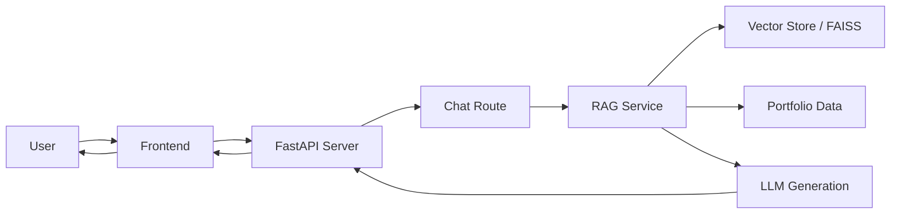

# Backend README

This backend powers the portfolio chatbot experience by serving a FastAPI application that accepts user questions, retrieves relevant portfolio context, and streams an AI-generated response.

## Overview

The backend combines:
- a FastAPI web server
- a retrieval-augmented generation (RAG) pipeline
- vector search with FAISS
- embedding generation via NVIDIA Inference API
- streamed chat responses

It is designed to answer questions about Pravesh's professional background, experience, education, skills, and projects.

## System Diagram



## Project Structure

```text
backend/
├── app/
│   ├── core/
│   │   └── config.py
│   ├── data/
│   │   ├── portfolio.txt
│   │   ├── texts.json
│   │   └── faiss_index.bin
│   ├── routes/
│   │   └── chat.py
│   ├── services/
│   │   ├── embed.py
│   │   ├── gemini.py
│   │   └── rag.py
│   └── main.py
├── run.py
├── requirements.txt
├── Dockerfile
└── Procfile
```

## Features

- Fast and lightweight API server using FastAPI
- Streaming chat responses for better user experience
- RAG-based retrieval from portfolio content
- Hybrid search using:
  - semantic/vector similarity search
  - keyword matching
- Automatic index creation from portfolio text on first startup
- CORS enabled for frontend local development and deployment

## Prerequisites

- Python 3.10+
- pip
- A valid NVIDIA API key

## Setup Instructions

1. Navigate to the backend folder:

```bash
cd backend
```

2. Create and activate a virtual environment:

```bash
python -m venv .venv
source .venv/bin/activate
```

On Windows PowerShell:

```powershell
python -m venv .venv
.venv\Scripts\Activate.ps1
```

3. Install dependencies:

```bash
pip install -r requirements.txt
```

4. Create an environment file:

```bash
cp .env.example .env
```

Then update the values in the .env file:

```env
NVIDIA_API_KEY=your_nvidia_api_key_here
```

5. Start the server:

```bash
python run.py
```

The API will run locally at:

```text
http://localhost:8000
```

## API Endpoints

### Health Check

```http
GET /health
```

Example response:

```json
{
  "status": "alive"
}
```

### Chat Endpoint

```http
GET /chat/?q=Tell me about your experience
```

This endpoint returns a streamed response suitable for chat interfaces.

## How the Chat Flow Works

1. The frontend sends a question to the chat endpoint.
2. The backend retrieves relevant chunks from the portfolio data.
3. The system combines vector similarity results with keyword matches.
4. The retrieved context is passed to the LLM.
5. The generated answer is streamed back to the client.

## Data Source

The main knowledge base comes from:

- [app/data/portfolio.txt](app/data/portfolio.txt)

On first run, the backend builds a FAISS index and stores it in:

- [app/data/faiss_index.bin](app/data/faiss_index.bin)
- [app/data/texts.json](app/data/texts.json)

## Deployment Notes

This backend is prepared for deployment using:
- Docker
- Procfile
- Render or similar cloud hosting platforms

If you deploy it, make sure the environment variable for the API key is configured in your hosting platform.

## Troubleshooting

- If the app cannot start, make sure your API key is present in the .env file.
- If no answers are returned, ensure the portfolio data file exists and the FAISS index is created successfully.
- If you see import issues, reinstall dependencies using the requirements file.

## Summary

This backend acts as the intelligent assistant layer for the portfolio website, turning portfolio content into a conversational experience through AI and retrieval-based search.
